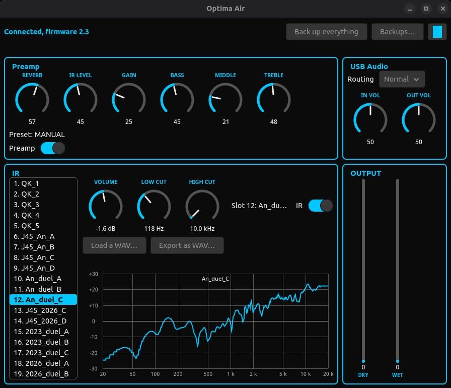

# optima-air-linux

A native Linux editor for the NUX Optima Air (NAI-5) acoustic guitar pedal: settings, impulse
responses, backups and restore, from a GTK 4 window or the command line.

> **Independent project.** Not affiliated with, endorsed by or supported by NUX / Cherub
> Technology. "NUX" and "Optima Air" are their trademarks, used here only to say which
> hardware this tool works with.

The interface is in English and French, following the language of your desktop.



## Features

- **Live state**: firmware version, active slot, the six preamp knobs, routing, USB volumes,
  IR and preamp on/off, DRY/WET level meters. Changes made on the pedal show up in the window.
- **Settings**: everything above can be changed with the mouse, plus volume, low cut and high
  cut per slot.
- **Impulse responses**: the 23 slots with their names, the curve of the selected IR, loading
  a WAV file into any slot (button or drag and drop), exporting a slot as WAV.
- **Backups**: full backup of the 23 slots in a few seconds (read only), list of backups,
  restore one slot or a whole backup. Only the slots that differ are rewritten.
- **Accent colour** of the interface, chosen from a palette or as `#rrggbb`.

What it does not do: firmware updates, presets, writing factory IRs back (see
[Safety](#safety)).

## Requirements

- The pedal on **firmware 2.3** (the version shown by the official app). Writing is refused
  on any other version.
- Linux with ALSA, Python 3.13, GTK 4 and PyGObject.
- Developed and tested on Debian 13 (trixie), GNOME 48.

On Debian or Ubuntu:

```sh
sudo apt install python3 python3-gi gir1.2-gtk-4.0 python3-numpy python3-scipy python3-soundfile gettext
```

The pedal appears as the ALSA card `NAI5` and is reached through its MIDI port
(`/dev/snd/midiC*D0`). No driver, udev rule or root access is needed, but your user must be
allowed to open `/dev/snd`: desktop sessions usually grant it, otherwise add yourself to the
`audio` group.

## Installation

A Debian package is on the way. Until then, run it from a clone:

```sh
git clone https://github.com/julienmary/optima-air-linux.git
cd optima-air-linux
tools/install-local.sh
```

This compiles the translations, links `~/bin/optima-air` to the clone and adds "Optima Air"
to the desktop menu. The code stays in the clone: `git pull`, then `tools/install-local.sh`
again to refresh the translations, is enough to update. `tools/install-local.sh --remove`
removes the link and the menu entry, and keeps your backups and preferences.

Without installing anything: `bin/optima-air window` (in English until the translations are
compiled with `tools/build-translations.sh`).

## Usage

`optima-air window` opens the window. The command line covers the same ground:

| Command | What it does |
|---|---|
| `state` | Firmware version, preset and settings |
| `slots` | The 23 slots: name, identifier, volume and filters |
| `read <slot>` | Back up the IR of a slot |
| `export <slot> <file.wav>` | Export a slot as WAV |
| `load <slot> <file.wav> [--name NAME]` | Write a WAV into a slot |
| `backup` | Back up the 23 slots |
| `backups` | List the backups |
| `restore <backup> [slot]` | Restore one slot, or every slot of a backup |
| `resume` | Check the pedal after an interrupted write |
| `listen` | Print what the pedal sends |

Slots are numbered from 1 to 23, as on the pedal and in the window. Commands that write ask
for confirmation (`--yes` skips it). `optima-air <command> --help` gives the details.

Backups live in `~/.local/share/optima-air/sauvegardes/`, preferences in
`~/.config/optima-air/`.

### Language

The interface follows the usual locale variables. To force a language for one run:
`LANGUAGE=fr optima-air window`, or `LANGUAGE=en` for English.

### Loading a WAV

The file is prepared the way the official app does it: first channel only, resampled to
48 kHz if needed, cut to 2048 samples (42.7 ms), then normalised so that the middle of its
level between 400 Hz and 3 kHz sits at 0 dB. The confirmation dialog lists what was changed,
and warns when the IR is longer than the pedal actually plays (see below).

## Safety

Not bricking the pedal is the first design rule.

- **What is written**: only what the official app writes for these features: the IR slots,
  their names, and the per-slot volume and filters. The firmware, the bootloader and the
  factory area of the pedal's memory are never addressed.
- **Before every write**, the slot is archived. The write goes through a single code path:
  fixed pacing, every acknowledgement checked, then the slot is read back and compared with
  what was sent.
- **If a write fails**, the tool keeps a journal, waits for the pedal to settle, and offers to
  restore the archived slot. Nothing is retried on its own.
- **Factory IRs** are stored in a separate area of the pedal and are not affected by writing
  a slot. This tool cannot write them back; the pedal's factory reset (which also erases your
  own IRs) or the official app can.
- **Not yet tried on real hardware**: a write interrupted halfway (cable pulled, crash). That
  path is covered by tests against a simulated pedal only.

Worst realistic case: a slot with a wrong IR, fixed by writing it again or by a factory reset.

## Technical notes

Everything below was worked out from the pedal's MIDI traffic and from static analysis, for
interoperability.

- **IR format**: 2048 little-endian float32 samples, mono, 48 kHz, stored in **reverse time
  order**, plus a 32-byte ASCII name and a 32-bit identifier (a custom CRC of the samples;
  bit 31 marks factory IRs).
- **Only 1024 coefficients are played**: the first 21.3 ms of the IR. The rest is stored but
  never convolved. An IR longer than that loses its tail.
- **Transport**: SysEx messages on the pedal's MIDI port. An IR upload is 89 messages: a
  header (slot and an MD5 of part of the data), 84 blocks of 98 bytes (8192 bytes of IR padded
  with zeros, each block 7-bit encoded with a leading byte of high bits, 115 bytes on the
  wire, with a 14-bit checksum), an end message carrying a 28-bit weighted sum, a footer, the
  name and identifier, and a final read of the slot's info.
- **Settings**: the global ones are plain MIDI Control Change messages; per-slot volume and
  filters are three tables of 23 entries, read and written by SysEx.

## License

GPL-3.0-or-later. See [LICENSE](LICENSE).
